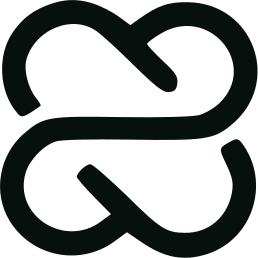

<p align="center">
  <a href="https://crafter.ing"><picture>
    <source media="(prefers-color-scheme: dark)" srcset="assets/crafter-glyph-dark.svg">
    
  </picture></a>
</p>

<h1 align="center">khipu-null</h1>

<p align="center">Rank khipus (quipus) against a reference pattern and test whether the match is chance.</p>

<p align="center">
  <a href="LICENSE"></a>
  <a href="https://pypi.org/project/khipu-null/"></a>
  
</p>

You describe a pattern (group sizes, which cords hold totals, colour repeats, attachment, value ranges). khipu-null scores every khipu in a corpus, ranks them, and compares each score against null versions of the same khipu where only the field that feature reads is permuted. Groups, positions and levels never move.

It answers three questions directly. Which khipus match the pattern? Which top k are the best candidates, and is that top k better than what you would pick by chance from the same corpus? Is any single match unlikely to be a coincidence, after correcting for testing hundreds of khipus?

Developed by [Crafter Research](https://crafter.ing) from the null designs validated in the [khipu colour and number analyses](https://crafter.ing/research/khipu-colour-legend).

## Quickstart

Requires [uv](https://docs.astral.sh/uv/).

```bash
uvx khipu-null --help
```

Try it on the public Open Khipu Repository:

```bash
curl -sL -o khipu.db https://raw.githubusercontent.com/khipulab/open-khipu-repository/v2.1.0/data/khipu.db
uvx khipu-null import-okr khipu.db -o okr.csv --errata confirmed
curl -sLO https://raw.githubusercontent.com/crafter-research/khipu-null/main/examples/santa-valley.yaml
uvx khipu-null rank okr.csv santa-valley.yaml -o out --top 6
```

`out/` gets `report.md`, `ranking.csv` and `summary.json`.

## Notebook

[](https://colab.research.google.com/github/crafter-research/khipu-null/blob/main/examples/quipu-analysis.ipynb) [](https://www.kaggle.com/code/raillyhugo/analisis-de-quipus-khipus-en-python)

[`examples/quipu-analysis.ipynb`](examples/quipu-analysis.ipynb), in Spanish: quipu analysis in Python from download to ranking, with the Open Khipu Repository, a khipu drawing, a pattern, the top-k test and how to read p and q. Runs in under a minute.

## Input format

Any CSV with one row per cord works:

| Column | Meaning |
|---|---|
| khipu_id | khipu identifier |
| cord_id | cord identifier, unique |
| group_id | cord group (cluster) |
| position | order along the khipu |
| level | 1 pendant, 2+ subsidiary |
| color | colour code as recorded |
| value | decoded knot value, empty if no knots |
| attachment | optional, recto/verso code |

## Patterns and nulls

Start from `examples/template.yaml`. Keep only the features your model predicts.

| Feature | Question | Null |
|---|---|---|
| `first_cord_range` | Are the first cords of runs in [min, max] more often than cords at random? | values shuffled across the khipu |
| `group_sum` | Does the first (or last) cord equal the sum of the others? | values shuffled among cords in the same slot of their group |
| `color_repeat` | Do colours repeat with this period? Single-colour groups are excluded. | colours rotated along the khipu (bands kept) |
| `attachment_split` | Are run-first cords tied with this code more than cords at random places? | attachments rotated along the khipu |
| `group_size` | Are groups made of whole units of this size? | none (structure) |
| `value_range` | Share of values in [min, max] | none (whole-khipu distribution) |

A feature spec can override its null with `null: within_khipu | within_group | within_slot | rotate`.

## Reading the report

- Per khipu: score, null mean, p (one-sided permutation) and q (Benjamini-Hochberg across all scored khipus).
- Top-k test: the mean score of your top k against the top k picked from null versions of every khipu. This is the honest answer to "are these five special, or would any five look this good?".
- `draws: auto` uses enough draws that a top-k khipu could reach q <= 0.05 if it beat every draw. With fewer draws, no khipu can be significant across a large corpus.

Example on the OKR (v2.1.0, KH0326 errata fixed), with a pattern written from the Santa Valley khipus. This is a sanity check, since the pattern comes from those khipus. Five of the six Santa khipus rank in the top 6 of 328; the top-6 mean is 0.994 against a null of [0.954, 0.986], p = 0.001; no single khipu reaches q <= 0.05.

## Three questions

| Question | khipu-null |
|---|---|
| Which khipus (quipus) match a model? | Score per khipu for the features in your pattern |
| Which five best represent it? | `--top 5` and the top-k test against null versions of every khipu |
| Regularity or coincidence? | Permutation p and Benjamini-Hochberg q per khipu |

## Spanish-column CSVs

Some exports of OKR 2.1.0 use Spanish column names, one row per pendant cord. Map them to the input format:

| Spanish column | khipu-null column |
|---|---|
| codigo_kh | khipu_id |
| cuerda_uid | cord_id |
| grupo_uid | group_id |
| posicion | position |
| nivel | level |
| color | color |
| valor | value |

```bash
uv run --with pandas python -c "
import pandas as pd
d = pd.read_csv('quipus.csv', encoding='utf-8-sig', dtype=str)
cols = {'codigo_kh': 'khipu_id', 'cuerda_uid': 'cord_id', 'grupo_uid': 'group_id',
        'posicion': 'position', 'nivel': 'level', 'color': 'color', 'valor': 'value'}
d[list(cols)].rename(columns=cols).to_csv('cords.csv', index=False)
"
uvx khipu-null rank cords.csv my-pattern.yaml -o out --top 5
```

Empty `valor` stays empty, so a cord without knots is never read as zero. Start your pattern from `examples/template.yaml`.

En español: khipu-null dice qué quipus son compatibles con un modelo, elige los cinco mejores candidatos con una prueba top-k y muestra si una correspondencia es una regularidad o una coincidencia, con un p de permutación y un q por quipu.

## Limits

- A low p says the match is unlikely under that null, given each khipu's structure. It does not say what a khipu means.
- Structural features cannot be tested by permuting a khipu. They rank, they do not prove.
- Shuffling colours cord by cord breaks colour bands and makes chance matches look rare. That is why colours rotate.
- Shuffling values across the whole khipu ignores position effects, such as larger first cords. That is why `group_sum` shuffles within slots.

## Data notes

OKR v2.1.0 and the Khipu Field Guide give single knots a different decimal place on KH0326 and KH0472 (OKR 100, Field Guide 10). `import-okr --errata confirmed` applies the Field Guide reading to KH0326, which Urton (2017, Appendix B) supports; `--errata all` also applies it to KH0472. This is an open discrepancy, not a confirmed error in OKR. Details: [audit-okr-kfg.md](https://github.com/crafter-research/khipu/blob/main/notes/audit-okr-kfg.md).

## Citation

If you use khipu-null, please cite it (GitHub's "Cite this repository" button reads `CITATION.cff`): Crafter Research (2026), khipu-null, https://github.com/crafter-research/khipu-null

## License

Code: MIT. Documentation and examples: CC BY 4.0.
